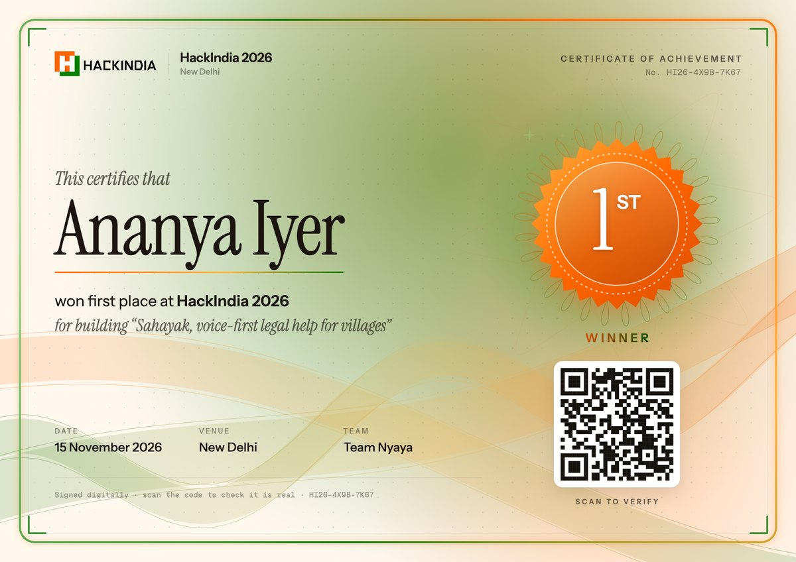
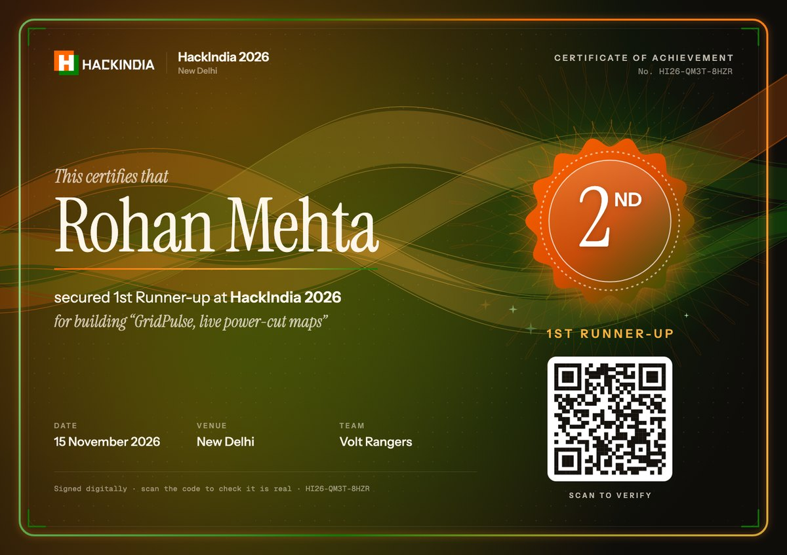
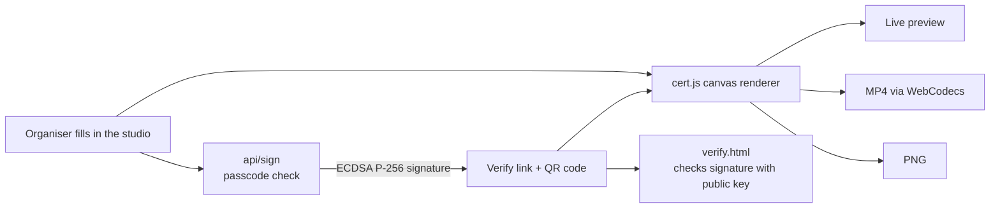

<div align="center">

# HackIndia Certificate Studio

**Animated, verifiable hackathon certificates that winners actually want to post.**

[](https://hackindia-cert.vercel.app)
[](https://hackindia-cert.vercel.app/verify.html)


[Live demo](https://hackindia-cert.vercel.app) · [Verify a certificate](https://hackindia-cert.vercel.app/verify.html) · [Quick start](#quick-start) · [How it works](#how-it-works) · [AI use](#ai-use-and-responsibility)



</div>

---

Every hackathon ends with a PDF that nobody posts. HackIndia Certificate Studio turns a list of results into
animated, tamper-proof certificates, each with a QR code that anyone can scan to check it is real. Winners
get a short looping video that is ready for LinkedIn, and every post they share brings attention back to the
event.

## Table of contents

- [Features](#features)
- [Quick start](#quick-start)
- [Usage](#usage)
- [How it works](#how-it-works)
- [Security model](#security-model)
- [Deployment](#deployment)
- [Project structure](#project-structure)
- [Browser support](#browser-support)
- [Roadmap](#roadmap)
- [Acknowledgements](#acknowledgements)
- [AI use and responsibility](#ai-use-and-responsibility)
- [License](#license)

## Features

| | |
|---|---|
| **Cinematic motion** | The border draws itself, a light sweeps left to right, the name writes on, the rank badge pops in and the QR code prints row by row. |
| **Unique identity** | The certificate ID seeds the ribbons, colour fields, dot wave, guilloche pattern and badge petals. No two certificates look alike, and the same ID always renders the same design. |
| **Official branding** | The official HackIndia logo and its exact colours: orange `#FF6600` and green `#137807`. |
| **Two themes** | *Paper* (light) and *Night* (dark). |
| **Six tiers** | Winner, 1st Runner-up, 2nd Runner-up, Finalist, Special Mention and Participant, each with its own badge shape and colours. |
| **Verifiable** | Every link and QR code carries the certificate details and an ECDSA P-256 signature. Change a single letter and the verify page shows **Not verified**. |
| **Seamless video** | A 9-second MP4 loop at 1280×904, encoded frame by frame in the browser with WebCodecs, and kept under 3 MB. The first frame shows the finished certificate, so the LinkedIn thumbnail looks right. |
| **LinkedIn ready** | *Add to profile* pre-fills LinkedIn's certification form. *Share post* and native file sharing on phones are also built in. |
| **Bulk issuing** | Paste a list, sign every certificate in one request, and download a CSV of verify links and LinkedIn links. |
| **No build step** | Plain HTML, CSS and JavaScript, plus one small serverless function. |

<div align="center">

</div>

## Quick start

**Requirements:** Node.js 18 or newer (only for making a local key), Python 3 (or any static file server),
and Chrome or Edge.

```bash
git clone https://github.com/rmagdaleena2508-01/hackindia-cert.git
cd hackindia-cert
node scripts/dev-key.mjs          # makes a local test key in issuer-key.js (git-ignored)
python3 -m http.server 8890
```

Open <http://localhost:8890>. On localhost the studio signs in the browser with your test key, so no
passcode is needed. Certificates signed with a test key only verify on your own machine.

## Usage

1. **Make one certificate.** Fill in the name, achievement, project, team and event, or pick a sample.
   Switch between *Paper* and *Night*, or click *New identity* for a fresh design.
2. **Export.** *Download video* saves the MP4 loop. *Download PNG* saves a 1600×1130 still.
3. **Share.** *Add to LinkedIn profile* opens LinkedIn's certification form, already filled in.
   *Share post* opens a LinkedIn post with the verify link.
4. **Issue in bulk.** Paste one person per line as `name, tier, project, team`, where tier is one of
   `winner`, `runner1`, `runner2`, `finalist`, `special` or `participant`. Issue them, then download the
   CSV of links.
5. **Verify.** Scan the QR code or open the link. The verify page replays the certificate and shows
   **Verified · signed by HackIndia**, or **Not verified** if anything was changed.

## How it works



- **One renderer.** `cert.js` draws everything on a single 1600×1130 canvas. The live preview, the PNG and
  every frame of the video come from the same `render(ctx, cert, t)` call.
- **Perfect loop.** All motion repeats every 9 seconds. In loop mode the content fades out just before the
  end, so the last frame matches the first.
- **Signed links.** A certificate becomes a short `|`-separated record, which is base64url-encoded and
  signed. The link is `verify.html#<record>.<signature>`. The verify page checks it with the public key
  using WebCrypto, with no server round trip.
- **Video.** `export.js` encodes H.264 with WebCodecs and packs it with `mp4-muxer`. If the file comes out
  over 3 MB, it encodes again at a lower bitrate. Browsers without WebCodecs fall back to MediaRecorder.

## Security model

- The private signing key is **never** shipped to the browser on the live site. It is stored as the Vercel
  secret `ISSUER_PRIVATE_JWK`.
- `api/sign.js` signs only when the request includes the issuer passcode (Vercel secret `ISSUER_PASSCODE`).
  It compares passcodes in constant time, accepts 1 to 500 certificates per request, checks the tier, and
  limits the length of every field.
- Anyone can open the studio and preview a certificate, but only the issuer can sign one.
- The public key in `public-key.js` is safe to share. It can only check signatures, not make them.
- `issuer-key.js` and any passcode files are listed in `.gitignore` and `.vercelignore`.

**Changing the passcode**

```bash
npx vercel env rm ISSUER_PASSCODE production
npx vercel env add ISSUER_PASSCODE production
```

Then push any commit to `main` to redeploy.

## Deployment

The repository is connected to Vercel. Every push to `main` deploys to production, and other branches get
preview URLs.

To deploy your own copy, import the repository in Vercel and set two environment variables:

| Variable | Value |
|---|---|
| `ISSUER_PRIVATE_JWK` | The private key as a JWK JSON string (EC, P-256) |
| `ISSUER_PASSCODE` | A long random passcode for issuers |

Then replace `public-key.js` with the matching public key.

## Project structure

```
hackindia-cert/
├── index.html          # Certificate studio for organisers
├── app.js              # Studio logic: form, preview, export, bulk issuing
├── verify.html         # Public verify page
├── cert.js             # Canvas renderer and animation timeline
├── sign.js             # Signing and verification (WebCrypto)
├── export.js           # MP4 and PNG export, LinkedIn links
├── logo.js             # Official logo embedded as data, so exports work from file://
├── public-key.js       # Public key used to verify signatures
├── style.css           # Studio and verify page styles
├── api/
│   └── sign.js         # Vercel serverless function: signs behind a passcode
├── assets/             # Official HackIndia logo files
├── docs/               # README images
└── scripts/
    └── dev-key.mjs     # Makes a local test key for development
```

## Browser support

| Browser | Status |
|---|---|
| Chrome (desktop) | ✅ Tested: studio, verify page, MP4 and PNG export |
| Edge, Safari, Firefox | Not tested yet. Browsers without WebCodecs fall back to MediaRecorder, which may save WebM instead of MP4. |

LinkedIn accepts MP4, so Chrome is recommended for exporting videos.

## Roadmap

- [ ] Custom domain, for example `certificates.hackindia.org`
- [ ] Short links (`/v/HI26-XXXX`) for simpler QR codes and the option to revoke a certificate
- [ ] Import results straight from a spreadsheet
- [ ] Test in Edge, Safari and Firefox, and on phones

## Acknowledgements

- The **HackIndia** name and logo belong to HackIndia ([hackindia.org](https://hackindia.org)). They are used
  here to show how the certificates would look. This is not an official HackIndia product.
- [qrcode-generator](https://github.com/kazuhikoarase/qrcode-generator) by Kazuhiko Arase (MIT)
- [mp4-muxer](https://github.com/Vanilagy/mp4-muxer) by Vanilagy (MIT)
- [Instrument Sans](https://fonts.google.com/specimen/Instrument+Sans),
  [Instrument Serif](https://fonts.google.com/specimen/Instrument+Serif) and
  [Geist Mono](https://fonts.google.com/specimen/Geist+Mono) via Google Fonts (SIL Open Font License)
- Sample names and projects in the studio are made up.

## AI use and responsibility

In creating this project, I collaborated with **Claude Code (Anthropic's Claude Opus 5.5)**, the only AI
tool I used, to assist with research, writing code, finding and fixing bugs, and drafting documentation.

**What I did myself:** I chose the problem: static PDF certificates that nobody shares. I wrote the design
brief: cinematic motion, HackIndia's orange and green without being stuck on a dark background, a unique
look for every certificate, a clear achievement badge, a QR code that proves it is real, a smooth loop, and
a file under 3 MB that feels worth posting on LinkedIn. I decided where it should live and how it should be
shared, and I asked for the official logo, the exact brand colours, and a privacy check before anything was
published.

**What the AI helped with:**

- Writing and changing the code (canvas renderer, signing, video export, studio and verify pages) based on
  my brief
- Moving signing to a server function, so the private key never reaches the public site
- Running checks: browser tests, signature tests, export size checks, and tests of the live site
- Drafting this README and the commit messages, which I then edited and approved

**How I reviewed it:** Each change was checked before it was kept. Video and PNG exports were measured
against the 3 MB limit. Signatures made on the server were checked against the browser's verifier.
Every verify link was tested both as issued and with one letter changed. The live site was checked after
each deploy, and the offline copy was tested from a fresh unzip.

I affirm that all AI-generated and co-created content underwent thorough review and evaluation. The final
output accurately reflects my understanding, expertise, and intended meaning. While AI assistance was
instrumental in the process, I maintain full responsibility for the content, its accuracy, and its
presentation.

**Context:** This is an independent project. It is not an official HackIndia product. This disclosure is
made in the spirit of transparency and to acknowledge the role of AI in the creation process.

## License

No open-source license has been chosen yet, so all rights are reserved by default. Please open an issue if
you would like to use this project.
